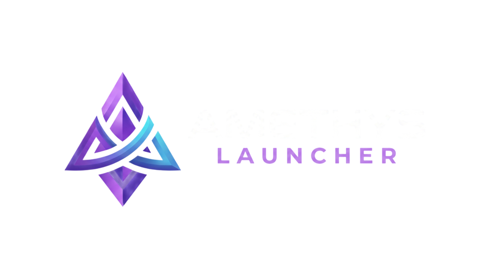

  
  
  

A free, community-driven, cross-platform game library and launcher client.

Amethys Launcher aims to bring game libraries, installations, updates, saves and platform integrations together without replacing the official stores, accounts, licenses, DRM or platform policies.

## Project status

The project is at **Core Foundation 0.1**. This first stage builds the Rust foundation before any graphical interface or store integration is introduced.

## Principles

- Windows, Linux and macOS are first-class targets.
- The core remains independent from any graphical interface.
- Official platform APIs and permitted mechanisms only; no DRM, licensing, authentication or anti-cheat circumvention.
- SQLite is the initial local database.
- Core/worker communication uses a versioned JSON + Serde protocol.
- No `unsafe` code in Amethys-owned Rust source.
- Errors must be explicit, identifiable and diagnosable.
- Tests and CI are required on every supported operating system.

## Initial development scope

1. Rust workspace and project conventions.
2. Core runtime and lifecycle.
3. Typed internal event system.
4. Cross-platform IPC protocol foundation.
5. Module, task and worker management foundations.
6. SQLite storage and configuration.
7. Structured logging, error codes and diagnostics.

The desktop GUI, store integrations, downloads, save synchronization and account system are intentionally out of scope for this foundation stage.

## Repository

This repository is currently named `Amethys-Launcher`. The project/product name is **Amethys Launcher**; the repository name can be changed separately later if desired.

## License

To be decided before the first public release.
